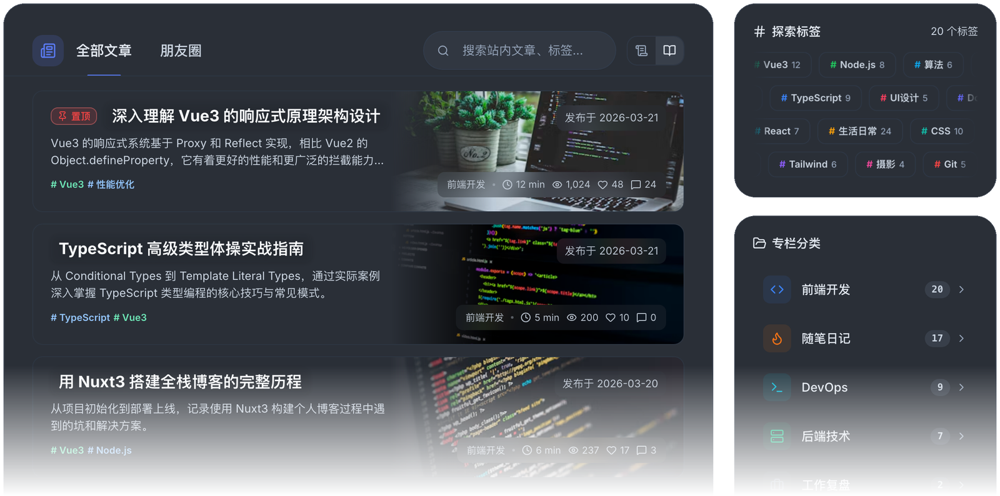

### 你好，我是 TixXin 👋

全栈开发，主要写 Nuxt / Vue / NestJS / TypeScript，喜欢把小工具做到能长期用。

现在在做 [TixXinBlog](https://github.com/TixXin/TixXinBlog)：一个能一条命令部署的个人博客系统，顺带维护 [nuxt-theme-engine](https://github.com/TixXin/nuxt-theme-engine) 等几件 Nuxt 基础设施。平时的记录写在 [tix.xin](https://tix.xin)。

